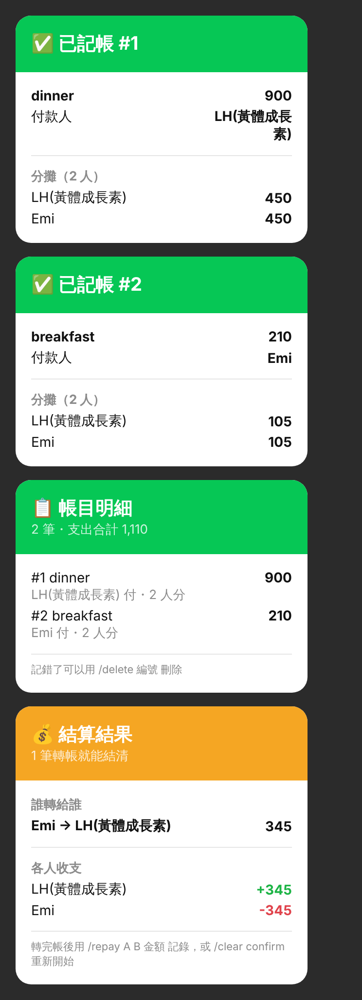
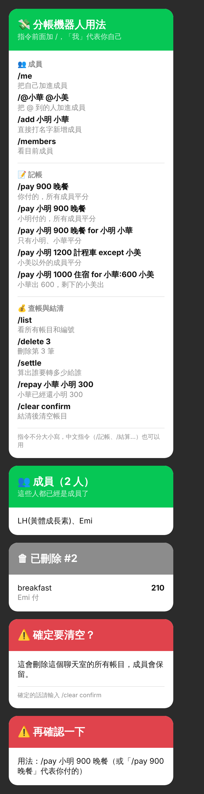

<div align="center">

# 💸 分帳小幫手

**LINE 群組分帳機器人**　·　[更新紀錄](CHANGELOG.md)

聚餐、旅遊時記下誰先付了錢，自動算出「誰要轉多少給誰」，轉帳筆數最少。

LINE ID：`@042zvtal`

</div>

<p align="center">
  
</p>

---

## 🚀 三步開始

1. **加好友**：搜尋 ID `@042zvtal`，把「分帳小幫手」加為好友。
2. **拉進群組**：在群組按「邀請」，選「分帳小幫手」。
3. **大家加入**：每個人輸入 `/me`，或由一個人 `/@小華 @小美` 一次加完。

之後輸入 `/help` 隨時可以看指令。每個群組各自一本帳，互不影響。

> 💡 **三個規則**
> - 指令前面一定要加 `/`，沒有斜線的訊息機器人不會理，不會吵到聊天。
> - 「我」代表你自己，沒寫付款人就是你付的。
> - 指令、名字、金額之間用空白隔開。

每則回覆下方都有快捷按鈕（💰 結算、📋 明細、🙋 加入、👥 成員、❓ 說明），點一下就送出。

## 📖 指令

### 👥 成員

| 指令 | 說明 |
|---|---|
| `/me` | 把自己加進成員 |
| `/@小華 @小美` | 把 @ 到的人加進成員 |
| `/add 小明 小華` | 直接打名字新增成員 |
| `/members` | 看目前成員 |
| `/remove 小美` | 移除成員（只能移除沒出現在帳目裡的人） |

### 📝 記帳

| 指令 | 說明 |
|---|---|
| `/pay 900 晚餐` | 你付的，所有成員平分 |
| `/pay 小明 900 晚餐` | 小明付的，所有成員平分 |
| `/pay 小明 900 晚餐 for 小明 小華` | 只有小明、小華平分 |
| `/pay 小明 1200 計程車 except 小美` | 小美以外的成員平分 |
| `/pay 小明 1000 住宿 for 小華:600 小美` | 小華固定出 600，剩下的小美出 |

金額可以寫 `1200`、`1,200`、`$300`、`300元`、`45.5`。

### 💰 查帳與結清

| 指令 | 說明 |
|---|---|
| `/list` | 看所有帳目和編號 |
| `/delete 3` | 記錯了，刪除第 3 筆 |
| `/settle` | 算出誰要轉多少給誰 |
| `/repay 小華 小明 300` | 小華已經轉給小明 300 |
| `/clear confirm` | 全部結清後清空帳目（成員保留） |
| `/help` | 顯示指令說明 |

指令不分大小寫；舊的中文指令（`/記帳`、`/結算`、`/明細`…，以及 `分`、`除了`）也能用。

## 🧾 範例：三個人出去玩

```text
/me                                   ← 小明、小華、小美各打一次
/pay 1,800 晚餐                        ← 小明付，三人各 600
/pay 小華 1200 住宿 for 小華 小美       ← 小明沒住，小華、小美各 600
/pay 小美 300 飲料 except 小明          ← 小明沒喝，小華、小美各 150
/settle
```

結算結果：

| 誰轉給誰 | 金額 |
|---|---:|
| 小美 → 小明 | 1,050 |
| 小華 → 小明 | 150 |

照著轉完就結清了。有人先轉了一部分，用 `/repay 小華 小明 150` 記下來，再 `/settle` 會算出剩下的。全部結清後 `/clear confirm`，下次出遊重新開始。

## ❓ 常見問題

<details>
<summary><b>記錯了怎麼辦？</b></summary>

用 `/list` 找到那筆的編號，`/delete 編號` 刪掉後重記。
</details>

<details>
<summary><b>錢除不盡怎麼辦？</b></summary>

整數金額以 1 元為單位分，多出來的 1 元給前面幾個人，不會出現 333.33 這種零頭。
</details>

<details>
<summary><b>機器人說讀不到我的名稱？</b></summary>

要先加機器人好友才讀得到 LINE 名稱。或者請別人用 `/@你` 把你加進來，記帳時直接打名字。名稱中間的空白會被去掉（`Leo Hsieh` → `LeoHsieh`）。
</details>

<details>
<summary><b>轉帳次數是最少的嗎？</b></summary>

結算時讓「欠最多的人先付給被欠最多的人」，n 個人最多 n-1 筆轉帳，一般情況就是最少筆數。
</details>

<p align="center">
  
</p>

---

## 🛠 開發與部署

給維護者看的說明。

### 在電腦上試玩（不需要 LINE）

需要 Node.js 22.13 以上。

```bash
npm install
npm run cli        # 互動模擬器，輸入「/名字 小華」切換發言的人
npm test
```

### 部署到 Cloudflare（免費）

跑在 Cloudflare Workers 上，帳目存在 Cloudflare D1 資料庫。免費額度是每天 10 萬次請求、5 GB 資料庫，一般群組分帳用不完。以下全部在網頁上完成，不用在電腦上裝任何東西。

#### 1. 建立 LINE 機器人

1. 到 [LINE Developers Console](https://developers.line.biz/console/) 建立 Provider，再建立一個 **Messaging API** channel。
2. **Basic settings** 頁籤：複製 **Channel secret**。
3. **Messaging API** 頁籤：發行並複製 **Channel access token (long-lived)**，再打開 **Allow bot to join group chats**。
4. 在 [LINE Official Account Manager](https://manager.line.biz/) 的「設定 → 回應設定」：「Webhook」打開、「自動回應訊息」關掉、「回應時間」關掉。
5. 「設定 → 帳號設定 → 功能切換」：「加入群組或多人聊天室」改成「接受邀請」。

#### 2. 建立資料庫

1. 登入 [Cloudflare Dashboard](https://dash.cloudflare.com/)，左側選 **Storage & Databases → D1 SQL Database → Create**，名稱填 `line-split-bot`。
2. 建好後複製畫面上的 **Database ID**，貼到這個 repo 的 `wrangler.toml` 取代 `REPLACE_WITH_YOUR_DATABASE_ID`，commit 到 GitHub。

資料表不用手動建，部署時會自動建立（`migrations/` 資料夾）。

#### 3. 從 GitHub 部署 Worker

1. Cloudflare Dashboard 左側選 **Compute (Workers) → Workers & Pages → Create → Import a repository**，連結 GitHub 並選這個 repo。
2. **Build command** 留空，**Deploy command** 填 `npm run deploy`，其餘用預設值，按 Deploy。
3. 部署完成後，到這個 Worker 的 **Settings → Variables and Secrets**，新增兩個 **Secret**：
   - `CHANNEL_SECRET`：步驟 1 的 Channel secret
   - `CHANNEL_ACCESS_TOKEN`：步驟 1 的 access token
4. **Settings → Domains & Routes** 把 workers.dev 的 Production 打開，記下網址，例如 `https://line-split-bot.你的帳號.workers.dev`。

之後只要推新的程式到 GitHub，Cloudflare 就會自動重新部署。

#### 4. 接上 LINE

1. 回到 LINE Developers 的 **Messaging API** 頁籤，**Webhook URL** 填 `https://你的Worker網址/webhook`，按 **Verify** 應該會顯示 Success，並打開 **Use webhook**。
2. 用 QR code 加機器人好友，把它拉進群組，輸入「/help」。

#### 用指令列部署（選用）

```bash
npx wrangler login
npx wrangler d1 create line-split-bot          # 把 database_id 貼到 wrangler.toml
npx wrangler secret put CHANNEL_SECRET
npx wrangler secret put CHANNEL_ACCESS_TOKEN
npm run deploy
```

本機開發可以建 `.dev.vars`（寫入 `CHANNEL_SECRET=...` 和 `CHANNEL_ACCESS_TOKEN=...`），執行 `npx wrangler d1 migrations apply DB --local` 後再 `npm run dev`。

### 檔案結構

- `src/index.js`：Cloudflare Worker 入口，驗證 LINE 簽章、回覆訊息
- `src/bot.js`：指令解析與回覆文字（不依賴 LINE，方便測試）
- `src/settle.js`：平分與結算演算法
- `src/card.js`：回覆卡片（LINE Flex Message）的排版
- `src/store.js`：D1 資料庫存取
- `migrations/`：資料表定義
- `cli.js`：本機模擬器（用 Node 內建 SQLite 模擬 D1）
- `docs/`：README 用的截圖
- `CHANGELOG.md`：各版本的更新紀錄
